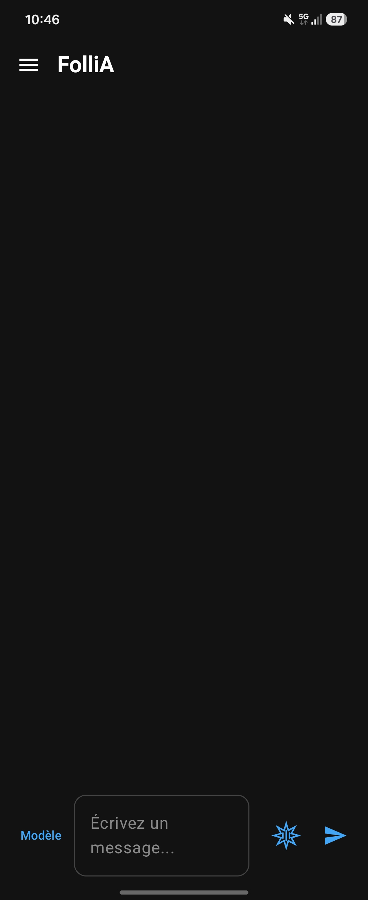
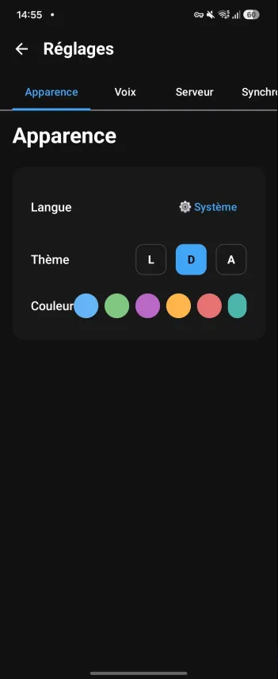
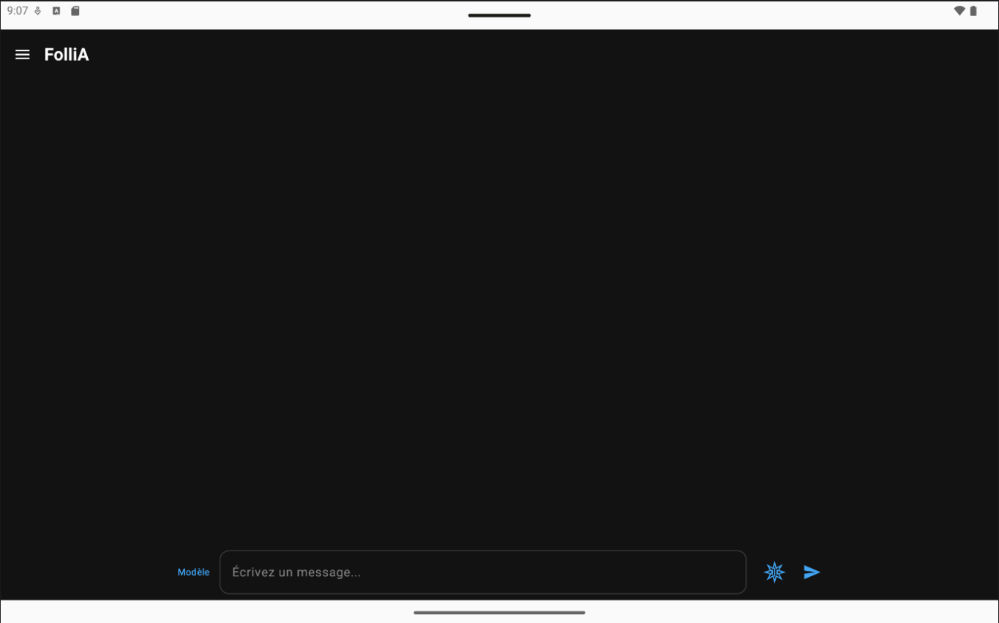
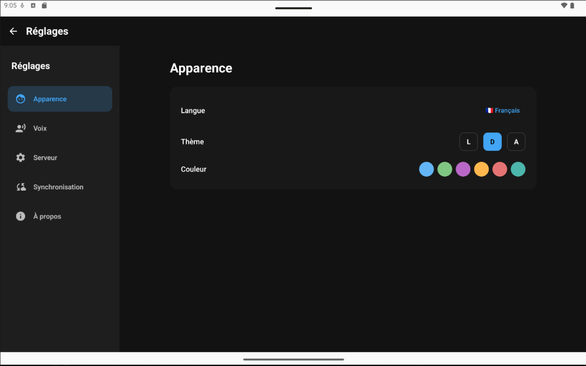

# 🧠 FolliA - L'IA locale et native. En toute confidentialité.

🌍 **[Visitez le Site Officiel de FolliA](https://iamtheamn.github.io/FolliA-website/index.fr.html)**

**FolliA** est un client Android natif, léger et 100% privé, conçu pour interagir avec vos modèles de langage locaux (LLM) via **[Ollama](https://ollama.com/)**. 

Parce qu'il faut un peu de folie pour vouloir faire tourner une IA dans sa poche, mais beaucoup de sérieux pour le faire de manière totalement souveraine.

## 📸 Captures d'écran

  
📱 <b>Voir l'interface Téléphone (Cliquez pour dérouler)</b>

   
  

    
    
  

  
💻 <b>Voir l'interface Tablette (Cliquez pour dérouler)</b>

   
  

    
      
    
  

## ✨ Fonctionnalités Principales
- 🎙️ **Conversations vocales mains-libres :** Discutez de voix à voix avec votre IA. La dictée fonctionne entièrement sur le téléphone grâce au moteur open source [Vosk](https://alphacephei.com/vosk/) : ni service Google, ni connexion.
- 📌 **Conversations organisées :** Épinglez, renommez ou supprimez vos discussions, toutes stockées sur l'appareil.
- ☁️ **Souveraineté des données & Nextcloud :** Sauvegardez vos historiques localement ou synchronisez-les de manière totalement privée via WebDAV (Nextcloud).
- 🛡️ **100% Privé & Indépendant :** Tout le traitement reste sur votre réseau local. Accédez à votre serveur domestique depuis l'extérieur via votre propre VPN. Zéro cloud tiers, zéro télémétrie, aucune dépendance aux services Google. Adresse du serveur et identifiants Nextcloud chiffrés sur l'appareil.

## 📱 Configuration Minimale
**Pour l'appareil Android :**
- Android 7.0 (API 24) ou version ultérieure.
- Connexion réseau active (Wi-Fi local ou réseau mobile via VPN).

**Pour le Serveur Hôte :**
- Un ordinateur ou nano-ordinateur (ex: Raspberry Pi) faisant tourner [Ollama](https://ollama.com/).
- Minimum 4 Go de RAM (8 Go+ fortement recommandés pour des modèles récents).

## 🚀 Démarrage Rapide

### Prérequis
1. **Ollama** doit être en cours d'exécution sur votre serveur.
2. Votre appareil Android doit pouvoir communiquer avec le serveur (même réseau ou VPN).
3. *(Important)* Assurez-vous qu'Ollama écoute les connexions externes en définissant la variable d'environnement `OLLAMA_HOST=0.0.0.0` sur votre machine hôte.

### Installation
1. Rendez-vous sur la page des **[Releases](../../releases)** du projet.
2. Téléchargez le fichier `.apk` de la dernière version disponible.
3. Installez l'APK sur votre appareil Android.
4. Ouvrez **FolliA**, allez dans les Réglages ⚙️, et entrez l'adresse IP de votre serveur.
5. *(Facultatif)* Pour la dictée vocale, téléchargez une fois le modèle de votre langue dans Réglages > Voix.

### ⚠️ Mise à jour depuis la v1.0
À partir de la v1.0.1, FolliA est signée avec une nouvelle clé. Android refuse donc d'installer la v1.0.1 par-dessus la v1.0 :
1. Dans la v1.0, exportez vos conversations : Réglages > Synchronisation > Sauvegarder.
2. Désinstallez la v1.0, puis installez la v1.0.1.
3. Restaurez votre sauvegarde depuis Réglages > Synchronisation > Restaurer, puis saisissez à nouveau l'adresse de votre serveur.

Politique de confidentialité : [iamtheamn.github.io/FolliA-website/privacy.fr.html](https://iamtheamn.github.io/FolliA-website/privacy.fr.html)

## 🤝 Soutenir le projet
FolliA est développé de manière totalement indépendante. Si l'application vous est utile, n'hésitez pas à laisser une ⭐ sur ce dépôt ou à m'offrir un café :

## 📜 Licence
Ce projet est sous licence **GNU General Public License v3.0** - voir le fichier [LICENSE](LICENSE) pour plus de détails.
